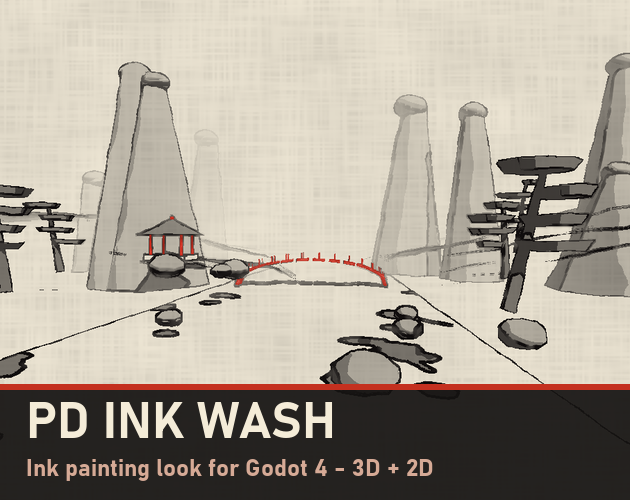
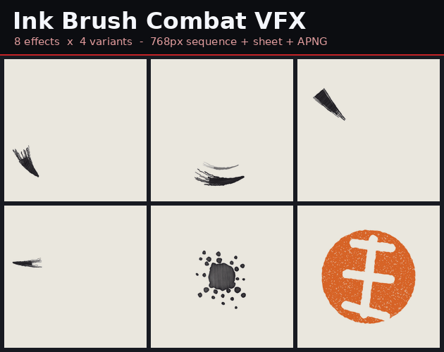
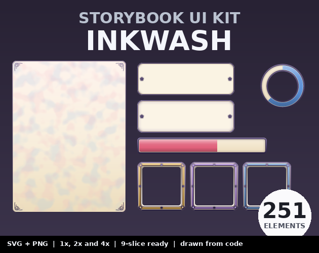
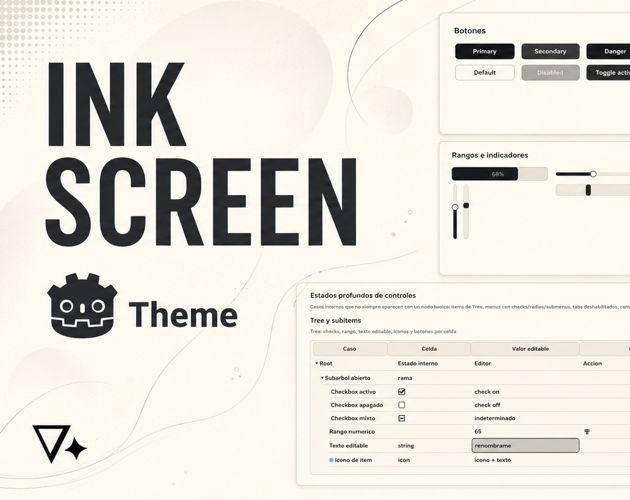

# itch.io 水墨风格素材调研（2026-10-20）

> 需求方：WuKong（Godot 4.7，第三人称跑酷 + 三连击，水墨后处理）。
> 检索方式：抓 itch.io 素材页 → 逐个打开详情页核对价格 / 引擎 / 许可。价格与许可是**页面原文**，未购买验证。

---

## 0. 先纠正一个入口

`https://itch.io/games/tag-runner` 是**游戏**列表页，不是素材页——里面 36 个都是可玩的跑酷游戏（Canabalt Classic、Minit Fun Racer、Planet Diver…），**没有一个水墨风**，也不能直接拿来用。

素材在另一侧：`game-assets`。而且 itch 上 `tag-ink-wash` / `tag-sumi` 是空标签，真正有内容的入口是：

| 入口 | 说明 |
|---|---|
| https://itch.io/game-assets/tag-ink | 36 个，水墨相关最集中的一页 |
| https://itch.io/game-assets/tag-wuxia | 36 个，武侠/仙侠（中文美术多） |
| https://itch.io/game-assets/tag-xianxia | 35 个，仙侠 |
| https://itch.io/game-assets/tag-chinese | 36 个，中式建筑/字体/音乐 |
| https://itch.io/search?q=ink+wash | 搜索比标签全，54 条 |
| https://itch.io/search?q=sumi-e | 41 条 |

**一句话结论**：市面上没有「水墨跑酷整包」，但**有一份几乎为本项目准备的 Godot 4 水墨后处理**（$9.99），其余按「墨迹纹理 / 打击 VFX / UI / 沿途场景」四块零买，总共 $15 左右能配齐。

**看图速览**（封面已下到 `docs/素材调研/`，可离线看）：

| | |
|---|---|
|  |  |
| PD Ink Wash：峰林 + 松 + 亭 + 红桥，纸纹与墨线都是 shader 实时出 | Ink Brush Combat：干笔斩痕、墨点爆开、朱红印章暴击 |
|  |  |
| Storybook Inkwash：奶油纸感 + 淡彩，**不是浓墨** | Ink Screen：黑白极简/e-ink，底子干净，要自己加纸纹和印章 |

---

## 1. 水墨渲染 / 后处理（最贴项目的一块）

### PD Ink Wash — Chinese & Japanese Ink Painting Look for Godot 4 · **$9.99**
https://pixeldreamerstudio.itch.io/pd-ink-wash-godot-4

- **6 种预设**：Shuimo（中国水墨，灰调 + 云雾山）、Sumi-e（日本墨绘，笔画更少更硬）、Ink & Vermilion（指定纯红物体保留朱砂色——**正好对应金箍棒/飘带**）、Night Ink、Light Wash、Ukiyo-e（浮世绘 7 色版画）
- 深度 + 颜色双通道描边，带手抖感；亮度分 3–6 级墨色 + 湿墨渗化；远处渐隐成白雾（跑酷远景白送层次）；宣纸纤维叠加
- **8 种墨笔场景转场**：笔扫、墨渗、云卷、竹帘、墨滴、山雾、卷轴展开、印章圆 —— 关卡切换直接用，一行 `InkTransition.change_scene("res://level_2.tscn", "ink_bleed")`
- 3D + 2D 都支持；Compatibility / Forward+ / Mobile 三种渲染器都跑，Godot 4.5+（我们是 4.7，没问题）
- 附 3D demo 场景（喀斯特峰林河谷 + 松 + 亭 + 红桥，代码生成）
- 作者实测：2012 年 GT 630 @1280×720，3D demo 52fps / 2D 77fps
- **许可**：任意数量免费或商业游戏可用、可改；不可把 shader/预设本身当素材包转卖。署名欢迎非必须
- 注意：透明粒子会被画在墨效之上（Godot 截屏机制），要用它的 ink object material 或不透明材质

### PD Ink Wash LITE · **免费（CC BY）**
同一页面的 “Download demo” 文件（5 kB zip），只有 Shuimo 3D 一个 look。
**建议先下这个**：把它的 shader 和我们现在 `assets/shaders/ink_post.gdshader` 并排比一次，再决定要不要付 $9.99。

### Sumi-E Demo in Godot · 免费（Godot 3）
https://mharitsnf.itch.io/sumi-e-demo-shader
老引擎的实现，代码可读，适合当「墨线怎么算」的参考，不能直接用。

### unity水墨资产【shader graph】【URP】· $50
https://mamenr.itch.io/unity-shuimo-shadergraph
Unity 专用，我们用不上；但它是少数**中文作者做的完整水墨 shader**，看截图能校准「留白 / 飞白 / 墨韵」的审美参考。

---

## 2. 墨迹 / 纸纹（替换现在的 `assets/textures/paper.png`）

| 名称 | 价格 | 内容 | 许可 | 链接 |
|---|---|---|---|---|
| Black Ink Washes | **$1** | 10 张无缝黑墨洗纹理，1024² / 4096² PNG，含笔触、积墨、飞溅、晕染 | 个人+商业可用；不可转售原图、不可用于 AI 训练 | https://evalynn.itch.io/black-ink-washes |
| Stray Ink | 免费 / 自定价 | 800 DPI 扫描墨线墨点，5 张 JPG | **CC BY-SA**：商用要署名，改动物需同协议 | https://ayeaka.itch.io/stray-ink |
| Ayeaka 其他 | 免费 | Ink Spill 1、Paint Splatter 1/2/3、Brayer 1（滚筒肌理） | 同作者，逐个看页面（多为 CC BY-SA） | https://ayeaka.itch.io/ |

用法：Black Ink Washes 的 4096 图当 `paper_tex` 或遮罩做溶解转场；糊 0.2 强度叠在墨线上就是「积墨」；Ayeaka 的泼溅可以直接当受击/落地的贴花。

---

## 3. 打击 / 招式 VFX（三连击用得上）

### Ink Brush Combat VFX Vol.1 · **$2.99**
https://taproot-solutions-llc.itch.io/ink-brush-combat-vfx-vol1

- 8 个招式 × 4 个变体 = 32 段 2D 序列帧：Brush Slash、Cross Slash、Crescent Sweep、Thrust Stroke、Ink Impact、Splatter Hit、**Seal Stamp Crit（朱红印章暴击）**、Dash Streak
- 每段给 4 种格式：768² PNG 序列 / 3840² 5×5 图集 / 带 alpha 的 APNG / 预览 GIF
- **不是 3D 粒子**，是 sprite flipbook——在 Godot 里挂 Sprite3D 或 UI 上都行，任何引擎表现一致
- 许可：商用免版税、无需署名；不可当素材包转卖

**这条对本项目价值最高**：三连击现在是「程序化插值、动作质量一般」（见 `docs/交接说明_跑步.md` §6.5），先用印章暴击 + 墨slash 的 2D flipbook 遮住动作短板，比重新 K 动画便宜得多。

配套还有 `Ink Brush Elements VFX Vol.1`（$2.99，墨点/墨烟/笔触元素）和 `Sprite VFX Complete Vol.4`（$21.99，288 个墨+霓虹特效，量太大，按需）。

### Xianxia VFX / Japanese VFX（Godot 4，3D 拖放）· $5.99 / $4.49
https://pixeldreamerstudio.itch.io/xianxia-vfx-godot-4
https://pixeldreamerstudio.itch.io/japanese-vfx-for-godot-4
御剑、符咒、法阵、雷劫 / 狐火、鸟居、樱花、居合斩。3D 场景 + 2D 序列图，比 2D flipbook 更适合我们第三人称 3D——**筋斗云、金箍棒旋棍、变身**这类可以用。

---

## 4. UI

**先说实话：itch 上没有现成的「浓墨 UI」**。三个候选都偏了半步，看封面就能判断：

| 名称 | 价格 | 实际长相 | 许可 | 链接 |
|---|---|---|---|---|
| Ink Screen Godot theme | **$2.47** | 黑白极简 / e-ink 风，**现代感**，不是毛笔墨韵。好处是完整 `.tres`，覆盖全部 Control 节点，改造成水墨的底子最省事（叠纸纹 + 印章角标） | 商用 Godot 项目可用、可改；不可单独转售 | https://galacticlake.itch.io/ink-screen-godot-theme |
| Hand-drawn Modular Ink UI | $12.99 | 粗墨线手绘 + 平涂色，965 PNG + 66 图标 + 7 配色，风格偏**可爱卡通**，不是文人水墨 | 页面未写许可，买前问作者 | https://iuliana-u.itch.io/hand-drawn-modular-ink-ui |
| Storybook UI Kit – Inkwash | $4.99 | 奶油纸底 + 淡彩描边，251 件 SVG 母版 + PNG 1x/2x/4x，全 9-slice（面板 132 / 按钮 38 / 物品槽 7 / 状态条 24 / 冷却环 17 / 徽章卷轴） | 商用免版税、无需署名；不可单独转售 | https://taproot-solutions-llc.itch.io/storybook-ui-kit-inkwash |
| 2000+ ink UI icons | $39 | 2000 个墨线图标 | 同上（未写），买前问 | https://iuliana-u.itch.io/2000-ink-icons |
| Inked Adventure Items | $4.99 | 手绘墨线物品/技能图标 + 图集 | 商用免版税、无需署名、可改 | https://stevencolling.itch.io/inked-adventure-items |

**我的建议**：`Ink Screen`（$2.47）当骨架 → 面板贴 Black Ink Washes 的纸纹 → 标题配 Ma Shan Zheng 毛笔字 → 按钮角上加朱红印章。这条路线比买 $12.99 的卡通墨线 UI 更贴你要的调子，成本也更低。

字体（不在 itch，但同一条线）：Google Fonts 的 **Ma Shan Zheng / Zhi Mang Xing / Liu Jian Mao Cao / ZCOOL XiaoWei**，OFL 协议，免费商用，做标题正好；正文别用。

---

## 5. 跑酷沿途场景 / 材质

| 名称 | 价格 | 内容 | 链接 |
|---|---|---|---|
| Stylized Asian PBR Textures Vol.1 | **$4.99** | 10 张无缝手绘风材质：瓦、竹、障子、榻榻米、漆、玉，2K+1K，Godot 4 ready | https://pixeldreamerstudio.itch.io/stylized-asian-pbr-textures |
| Asian Fantasy Parallax Backgrounds | **$4.99** | 12 个场景 × 昼/昏/夜，像素 + HD 两版，**Godot 4 场景已搭好** | https://pixeldreamerstudio.itch.io/asian-fantasy-parallax |
| Asian Visual Novel Backgrounds | **$4.99** | 12 场景 × 3 时段 = 36 张 1080p | https://pixeldreamerstudio.itch.io/asian-visual-novel-backgrounds |
| LinXueLian VN 背景（仙侠） | 免费 | 中式庭园 / 枫叶客栈 / 樱园 / 河畔别院，1280–1920px | https://linxuelian.itch.io/bgres-xxwx-cngarden-photoedited |
| Xuanhuan Mood Art | 免费 | 24 张东方幻想插画（过场/标题图） | https://willyee.itch.io/xuanhuan-mood-art |

3D 跑酷沿途要的是**中景山体/建筑 + 远景雾**：`Stylized Asian PBR Textures`（$4.99）配 `PD Ink Wash` 的远雾衰减，基本能用代码拼出「峰林—亭—桥」的跑酷带；2D 视差那条线则直接买 `Asian Fantasy Parallax`（含 Godot 场景）。

---

## 6. 三条采购路线

**A. 先白嫖验风格（$0）**
PD Ink Wash LITE（CC BY）+ Ayeaka 墨点 + LinXueLian 背景。跑一次看 4.7 里移动端帧率，够了再谈买。

**B. 一站式（$19.99，原价 $49.42，省 59%）**
https://itch.io/s/204988/asian-fantasy-game-kit-xianxia-wuxia-japan

8 个包：PD Ink Wash、Xianxia VFX、Japanese VFX、Xianxia UI & Formation Circles、Jade & Ink（Ren'Py GUI）、Asian Fantasy Parallax、Asian VN Backgrounds、Stylized Asian PBR Textures。
→ **这是最划算的一条**：PD Ink Wash 单买 $9.99，加 $10 就把材质、视差背景、两套 VFX、法阵 UI 全带走。**注意**：Parallax 是像素风、Jade & Ink 是 Ren'Py，这两件我们用不上，别为它们付钱——但如果本来就想要仙侠 VFX，这单不亏。

**C. 精确补刀（$13.46）**
PD Ink Wash $9.99 + Ink Screen 主题 $2.47 + Black Ink Washes $1 = $13.46，全是我们真正会用的东西（想要打击特效再加 $2.99）。

---

## 7. 和现有工程怎么接

| 现有 | 建议 |
|---|---|
| `assets/shaders/ink_post.gdshader`（canvas_item，亮度差描边 + 纸纹，39 行） | 现在**没有深度**，3D 里描边只能靠颜色差，人物和背景交界会漏。PD Ink Wash 走深度+颜色双通道，这是质变点；先拿 LITE 对比 |
| `assets/textures/paper.png` | Black Ink Washes 4096 图替换，`paper_tex` 强度 0.35 → 0.2 左右，墨线更干净 |
| 三连击（程序化插值） | Ink Brush Combat 的 Seal Stamp Crit + Brush Slash 做成 2D flipbook 挂在 `Sprite3D` 上，按帧触发 |
| 移动端优先 | PD Ink Wash 支持 Mobile 渲染器；先把分辨率缩放 0.75 + 后处理精度降一档测帧率 |
| 关卡切换 | `InkTransition.change_scene(..., "ink_bleed")` 一行，比现在硬切好 |

---

## 8. 我核实了什么、没核实什么

**核实过**（抓页面原文）：标题、价格、货币、内容清单、格式、引擎版本要求、许可条款（PD Ink Wash / Ink Brush Combat / Storybook UI / Black Ink Washes / Ink Screen / Inked Adventure Items / Stray Ink）。

**没核实**：能否真的下载/运行（未购买）、作者宣称的帧率、`iuliana` 那两包的许可（页面没写）、素材与 Godot 4.7 的实测兼容性。

**风险点**：
- itch 上「水墨」多为 2D 手绘/像素，**3D 水墨等于没有**——3D 部分只能靠后处理 shader + 写实材质凑，和我们 `docs/brief.md` §1 的判断一致
- CC BY-SA（Ayeaka 系列）用于商业项目要署名 + 改动物同协议，建议只当占位素材
- 单人作者的包更新不保证，买前看最后更新日期

---

*检索时间：2026-10-20；抓取方式：itch.io 页面 HTML → 文本抽取，价格/许可为当日页面原文。*
